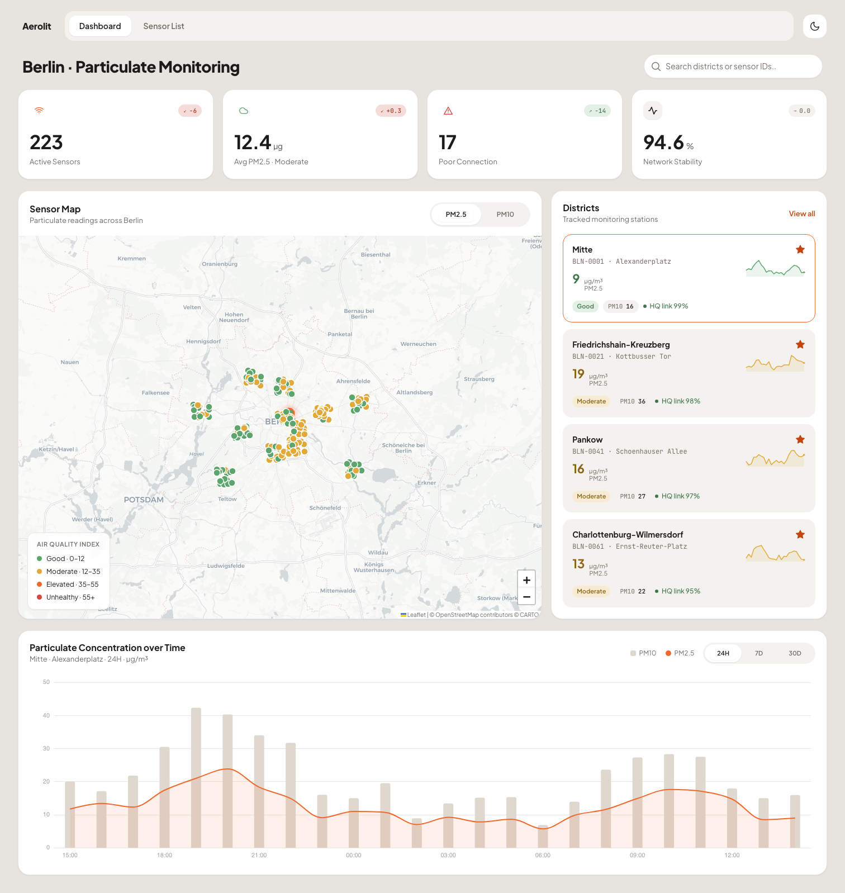
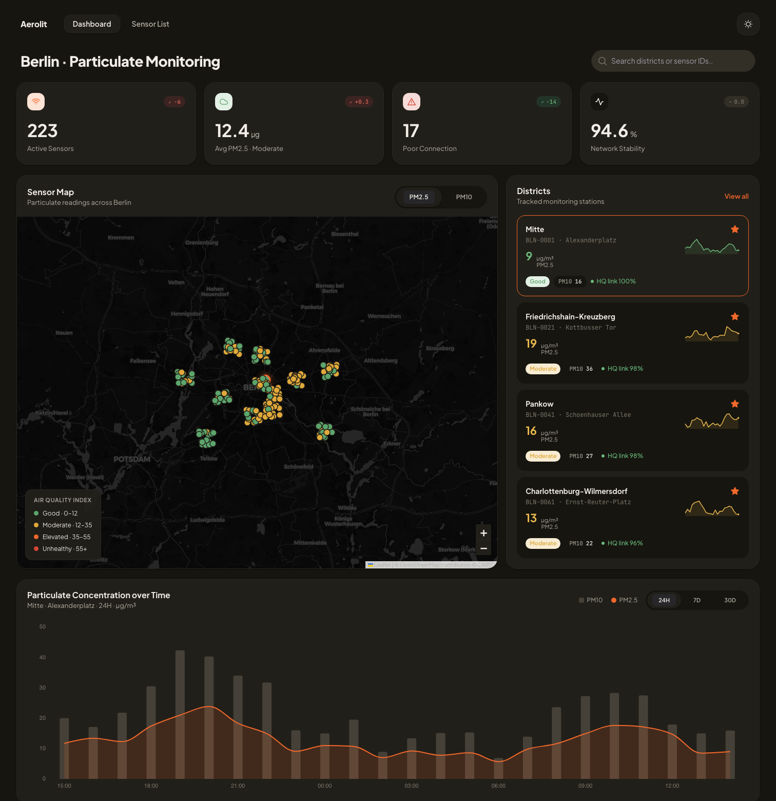
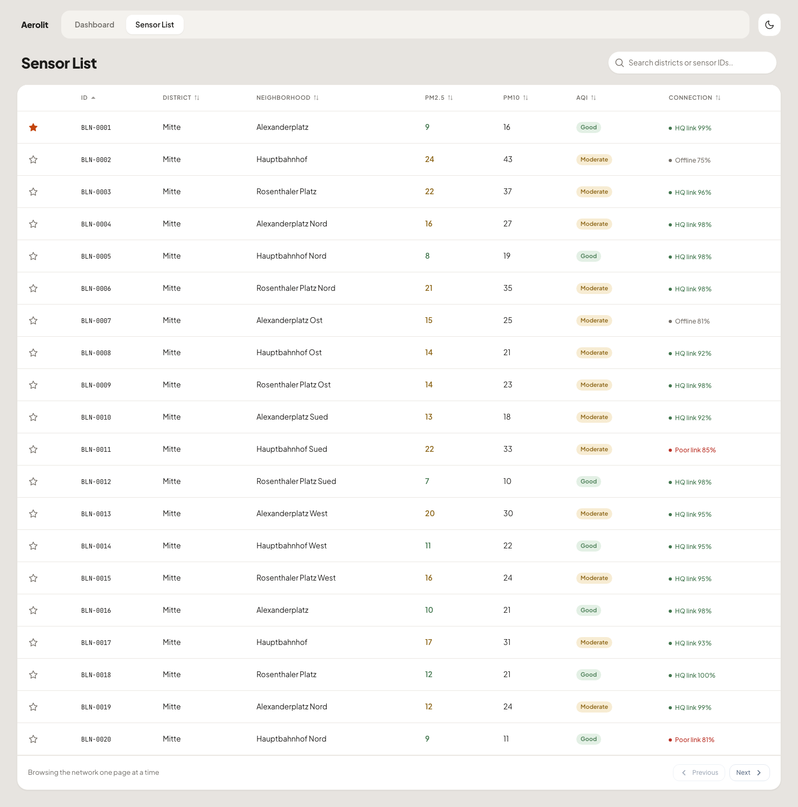
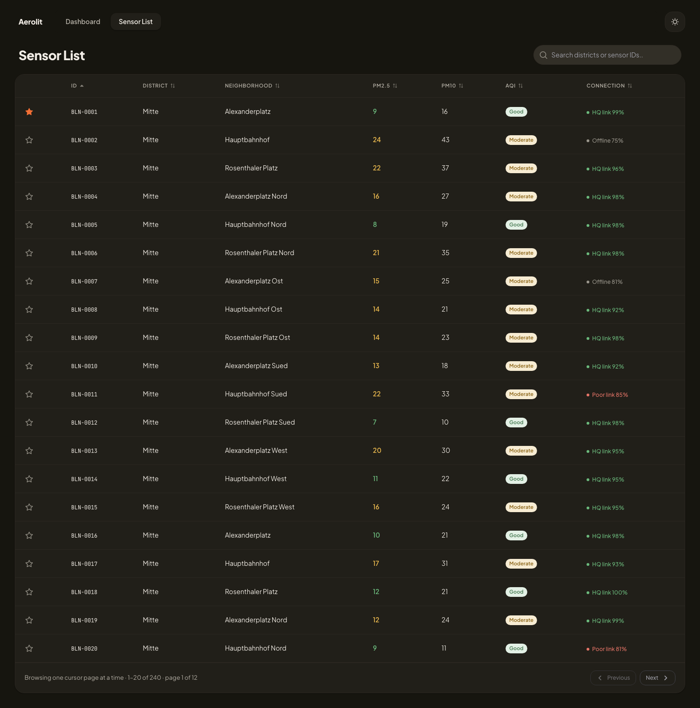
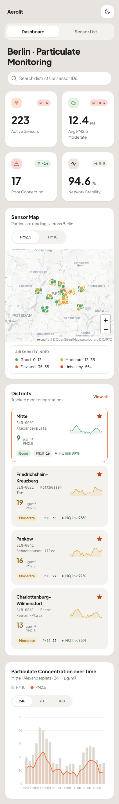
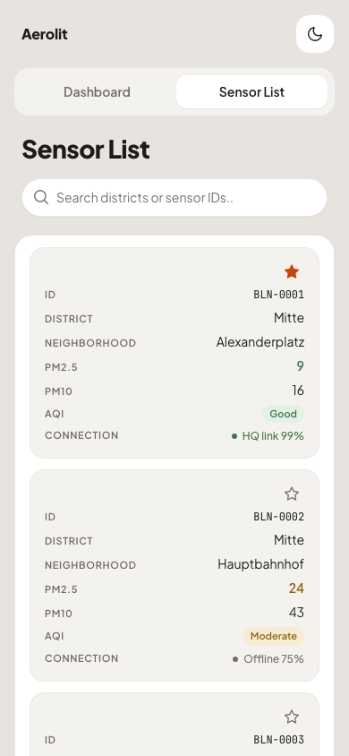

# Aerolit — Berlin Particulate Monitoring

Operator dashboard for a network of 240 low-cost air-quality sensors across
Berlin, built for the Wised frontend home assignment.

**Vue 3 · TypeScript · Vite · PrimeVue · Leaflet · ECharts**

> **The reasoning behind this is in [`NOTES.md`](NOTES.md)** — trade-offs,
> assumptions, what I left out and where I disagreed with my tools. Individual
> decisions are written up as ADRs in [`docs/adr/`](docs/adr/).
>
> The original assignment brief is preserved at
> [`docs/assignment-brief.md`](docs/assignment-brief.md) and
> [`frontend/README.md`](frontend/README.md).

---

## Running it

Requires Node ≥ 20.19 (`.nvmrc` pins 24).

```bash
cd frontend
npm install
npm run dev:full     # mock API on :8787 + Vite on :5173
```

Then open <http://localhost:5173>.

To run the two processes separately:

```bash
npm run mock-api     # http://localhost:8787
npm run dev          # http://localhost:5173
```

The app talks to a same-origin `/api` prefix that Vite proxies to the mock
server, so there is no CORS setup and no environment file to fill in.

## Screenshots

| | Light | Dark |
| --- | --- | --- |
| **Dashboard** |  |  |
| **Sensor List** |  |  |

At phone width the table becomes one card per station, and the sorting that
lives in the column headers moves into the footer:

| Dashboard, 390 px | Sensor List, 390 px |
| --- | --- |
|  |  |

Both pages hold up from 2560 px down to a 768 px iPad in either orientation,
and there is a phone layout below that — not required by the brief, but the
sensor table needed to stop being a table rather than merely get narrower. No
interaction depends on hover.

## What's implemented

**Dashboard** (`/dashboard`) — four KPI tiles with **real week-over-week trend
badges** (not placeholders), an OpenStreetMap sensor map with AQI-coloured
markers and a PM2.5/PM10 toggle, a persisted district watchlist with 24-hour
sparklines, and a full-width PM10-bars / PM2.5-line chart over 24H, 7D or 30D. The window
trails the snapshot hour while the bars are cut on the Berlin clock, which is
two decisions rather than one — [ADR 0010](docs/adr/0010-chart-windows-and-buckets.md)
says why. Selecting a station anywhere — map marker, watchlist row — loads it
into the chart.

**Sensor List** (`/sensors`) — the network as a sortable table, cursor-paginated
in both directions with controls that disable exactly when the API omits the
corresponding cursor. Typing a search, or sorting by a measured column, switches
the table to a mode that can answer that question across the whole network; the
footer says which mode is active. See [ADR 0006](docs/adr/0006-table-pagination-search-sort.md).

**Throughout** — light and dark themes from one token set, covering map tiles
and chart palette, surviving a reload and defaulting to the OS preference. The
dashboard's selection lives in the URL (`?station=&range=&pollutant=`), so what
an operator is looking at survives a reload and can be sent to someone else.

## How it's put together

```
frontend/src/
  api/          typed client — the only place that knows URLs and wire formats
  domain/       pure functions: AQI, stability, connection, KPIs, trends,
                bucketing, axis labelling, sorting. No Vue, no I/O, no
                ambient clock.
  queries/      TanStack Query composables — caching and request lifecycle
  stores/       Pinia — theme, selection, watchlist (UI state only)
  components/   ui/ = shared elements on top of PrimeVue · layout/ = app shell
  features/     dashboard/ and sensors/ compositions
  pages/        route targets
  theme/        design tokens + the PrimeVue preset that consumes them
```

Dependency direction is `pages → features → (ui, queries, stores) → (api,
domain)`, and `domain/` depends on nothing. That boundary is enforced by ESLint,
not convention — see [`docs/ARCHITECTURE.md`](docs/ARCHITECTURE.md).

What it buys is measurable rather than aesthetic. The brief names a network of
~10 000 stations; at that size the per-station series are **382 MB** against
9.2 MB here, so the roll-up has to move to the server.
[ADR 0011](docs/adr/0011-scaling-to-ten-thousand-stations.md) works that through:
**four files change** — the ones whose job is fetching — and the 13 modules of
`src/domain/` move server-side unchanged, because they are pure by contract with
the snapshot instant passed in rather than read from a clock.

## Scripts

| Command | |
| --- | --- |
| `npm run dev` / `dev:full` | Vite dev server, alone or with the mock API |
| `npm run build` | Type-check, then production build |
| `npm run test` / `test:coverage` | Vitest; coverage gates the domain and API layers |
| `npm run test:e2e` | Playwright: desktop, iPad on Chromium **and** WebKit, phone, plus visual baselines (first run: `npx playwright install chromium webkit`) |
| `npm run test:all` | The whole gate: lint → types → unit → e2e |
| `npm run lint` / `format` | ESLint (zero warnings allowed) · Prettier |
| `npm run typecheck` | `vue-tsc` across app, tests and config projects |

## Tests

**189 Vitest + 124 Playwright**, all green: 37 browser tests at desktop and at
iPad width on two engines, 9 that only make sense at phone width, and 4 pixel
baselines.

```bash
cd frontend
npm run test                        # unit, component and integration
npx playwright install chromium webkit   # once
npm run test:e2e                    # builds, then runs every viewport
```

Four layers, each answering a different question:

| Layer | What it proves |
| --- | --- |
| **Unit** (`src/**/*.spec.ts`) | The domain functions are right at their boundaries — AQI band edges, missing hours, the offline rule, nulls-last sorting. |
| **Dataset** ([`tests/dataset.spec.ts`](frontend/tests/dataset.spec.ts)) | The *definitions* are right. The domain layer runs against the real shipped data and is pinned to figures computed independently, so redefining the stability window fails a test instead of quietly producing a plausible wrong dashboard. |
| **Integration** (`tests/*.spec.ts`, MSW) | The pages wire up — real router, store and query client, stubbed network. |
| **End-to-end** (`e2e/`, Playwright) | The **built bundle** against the **real mock API**: the cursor round-trip, the map and chart rendering, the theme surviving a reload. Runs at 1512 px, 768 px on Chromium *and* WebKit — an iPad is a Safari — and 390 px for the layout that differs rather than shrinks, with an `axe-core` pass over both pages in **both themes** at every one of them. |
| **Visual** (`e2e/visual.spec.ts`) | Pixel baselines for both pages in both themes: the one class of defect the others cannot see — a token pointed at the wrong colour, a card that lost its border. Map tiles masked; baselines are macOS-captured and skip elsewhere. |

CI runs all of it: [`.github/workflows/ci.yml`](.github/workflows/ci.yml).
